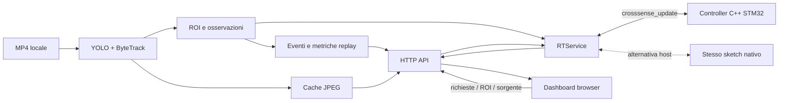

# Architettura software CrossSense

Revisione: 11 ottobre 2026. Perimetro concordato: replay dichiarato, dashboard, nessun attuatore fisico.

## Obiettivo e confini

Rilevare utenti in MP4 locali, richiedere automaticamente l’attraversamento, governare un semaforo logico, proteggere l’occupazione e mostrare conteggi, direzioni e allarmi. Nessuna camera live, controllo stradale reale, classificazione di disabilità, previsione metrica o servizio cloud. I video non reagiscono al controller: un pedone può entrare durante il verde veicoli e questo deve produrre un conflitto.

La UNO Q esegue Linux e firmware STM32. Il browser può essere su un computer esterno; chiuderlo non interrompe né inferenza né controller. Il profilo nativo PC sostituisce il trasporto MCU con un processo dello stesso sketch compilato con stub Arduino; non replica la logica in Python e non riproduce lo scheduling Zephyr.

## Componenti e dipendenze

| Componente | Proprietà e responsabilità | Implementazione |
|---|---|---|
| HTTP | Risorse statiche, API, startup/shutdown dei worker | `dashboard/server.py`, libreria standard Python |
| Visione | Un solo modello/tracker/capture, detection, frame JPEG, revisione ROI | `vision/pipeline.py`, Ultralytics/OpenCV/ByteTrack |
| Catalogo | Percorsi MP4 consentiti e selezione persistente | `vision/sources.py` |
| ROI | Quattro poligoni normalizzati e salvataggio atomico con revisione | `vision/zones.py` |
| Eventi replay | Traiettorie parziali, completamenti, direzioni, attesa e immobilità | `vision/events.py` |
| Adapter RT | Ultima osservazione, identità wire, richieste, cache telemetria, episodi allarme | `dashboard/rt.py` |
| Controller | Ricezione atomica, validità, permanenza nelle attese, richieste e macchina a stati | `firmware/sketch/rt_protocol.h`, `standard_cycle.h` |
| Trasporto host | Processo dello sketch reale, timeout e restart | `dashboard/native.py`, `firmware/tests/native_bridge.cpp` |
| Browser | Presentazione e richieste; nessuna decisione del controller | `dashboard/static/` |
| Packaging | App Lab, asset, requirements e opzione ciclo | `scripts/package_rt.py` |

Il backend usa un singolo processo: thread HTTP, worker visione e worker Bridge. Questa scelta evita servizi distribuiti e mantiene l’app adatta all’hackathon. Un crash del processo invalida le osservazioni sulla MCU attraverso il watchdog. Non è configurato nel repository un supervisore di sistema o un autostart al boot.

| Ambiente | Entry point e avvio | Configurazione / asset | Stato |
|---|---|---|---|
| Linux UNO Q | App Lab / `arduino-app-cli app start`, container `/run.sh` → `python/main.py` | `app.yaml`, requirements ARM, `vision-source.json`, MP4 e directory NCNN locali | Avvio e inferenza reali collaudati |
| MCU STM32 / Zephyr | `sketch/sketch.ino`: `setup()` / `loop()`, compilato e caricato da App Lab | `sketch.yaml`, RouterBridge incluso, ArduinoJson, `controller-cycle.enabled` tradotto in macro nel packaging | Firmware caricato e RPC reali collaudati |
| Browser esterno | HTTP `:8080` → `index.html`, `app.js`, provider e viste | ROI/layout e selezione persistiti sul backend; nessun modello nel browser | Edge su LAN collaudato |
| PC di sviluppo | `dashboard/server.py --native-controller …`, eseguibile generato da `build_native.py` | Dipendenze host e stub di test; stesso sketch C++ | Alternativa per sviluppo, non misura Zephyr |
| Preparazione online | `prepare_replays.py`, export modello, `package_rt.py` | Manifest degli asset, toolchain e dipendenze da predisporre | Necessaria prima del runtime offline; nessun servizio cloud nel percorso attivo |

## Diagramma

Il generatore sintetico è una sorgente alternativa esclusiva; l’API rifiuta osservazioni esterne quando il video è attivo. Il simulatore UI è separato e non alimenta `RTService`.

## Startup e deployment

1. Parsing CLI, carico layout/ROI/selezione. Senza opzioni video non seleziono implicitamente il catalogo.
2. Scelta esclusiva trasporto: Bridge UNO Q oppure eseguibile nativo; nessuno per il simulatore UI.
3. Bind HTTP. La porta occupata è un errore di avvio.
4. Avvio worker RT: senza immagini invia indisponibilità.
5. Verifica asset locali e avvio visione. Un asset mancante lascia disponibili HTTP e stato di errore.
6. Apertura MP4, caricamento modello e prime osservazioni. Il controller recupera attraverso 500 ms di clear stabile e 1 s tutto rosso.
7. Browser legge configurazione e sceglie il percorso controller quando disponibile.

`firmware/python/main.py` legge `vision-source.json` nel pacchetto App Lab. `--controller-cycle` abilita il controller; `--standard-cycle` abilita anche la prova sintetica, incompatibile con video. Tutti i Bricks sono vuoti. Le dipendenze ARM sono in `vision/requirements-unoq.txt`; quelle host in `vision/requirements.txt`. Nessun download del modello durante l’esecuzione.

## Modello dati e clock

Detection Linux: `{id, class, label, confidence, bbox, zone}`. Classi COCO inoltrate: 0, 1, 2, 3, 5, 7. Le classi aggregate sono pedestrian, bicycle, vehicle. Un’ambulanza non è riconosciuta come categoria dedicata; la priorità è un comando esplicito.

RPC `crosssense_update(frame_json) -> state_json`. JSON max 900 byte per lato, massimo 8 tracce. Traccia: `[id,class,zone,x_mm,y_mm]`; nel replay corrente x/y sono sempre null. Confidence e bbox restano su Linux. Il campo crossing indica occupazione pedonale/ciclabile (o classe other conservativa): un veicolo transitante nella ROI crossing non genera da solo un conflitto pedonale. Python e MCU applicano la stessa regola. I campi storici `buzzer` e `beacon` rimangono false per compatibilità del protocollo: non rappresentano periferiche. `estimates` resta vuoto, senza calibrazione.

Due tempi distinti:

- `time_ms` e `age_ms`: clock monotono reale di acquisizione, inferenza inclusa nell’età; alimentano il watchdog. Non sono confrontati direttamente con `millis()`.
- `video_ms`: indice frame / FPS del file; alimenta attese osservate, permanenza per conteggio e immobilità. Il replay elabora tutti i frame e può rallentare.

`stream` cambia al reset sorgente/tracker/ROI; `RTService` assegna un’identità wire distinta per poter includere i messaggi senza immagine. `applied_stream` e `applied_frame` identificano l’osservazione effettivamente consumata dal loop. La risposta può riferirsi al tick precedente.

## Controller logico

Stati: FAULT → ALL_RED_TO_VEH → VEHICLE_GREEN → VEHICLE_YELLOW → ALL_RED_TO_PED → PED_GREEN → PED_CLEARANCE → ALL_RED_TO_VEH. PROTECTED_STOP interviene su conflitto o massimo sgombero.

| Regola | Implementazione |
|---|---|
| Richiesta automatica | Persona/bicicletta nelle ROI di attesa per 800 ms validi; un impulso per gruppo; riarmo dopo 1 s di attese vuote |
| Verde veicoli | Minimo 5 s con approach present, 1 s con approach clear; senza richiesta rimane verde |
| Priorità simulata | Durante verde veicoli mantiene la fase fino a 5 s; non interrompe protezione o fase pedonale |
| Giallo / tutto rosso | 2 s / 1 s |
| Verde pedoni | 5 s, oppure 8 s per richiesta accessibile |
| Sgombero | Entrambi rossi, minimo 1 s, uscita solo con clear stabile; massimo 10 s produce allarme |
| Timeout / dato invalido | FAULT con entrambi rossi immediatamente, scelta esplicita per dashboard-only |
| Conflitto | Occupazione durante verde/giallo veicoli → PROTECTED_STOP e CROSSING_CONFLICT |
| Recupero | Osservazioni valide e libere per 500 ms, poi 1 s tutto rosso; anche dopo CLEARANCE_TIMEOUT |

La finestra clear è valutata su un’osservazione ancora valida, non necessariamente su molti frame distinti. Il watchdog impedisce che un duplicato la prolunghi indefinitamente. Nessun timer autorizza veicoli quando crossing non è clear. I due semafori pedonali della dashboard condividono lo stesso stato.

## Conteggi ed eventi

`CrossingEvents` è proprietario delle metriche. Accetta risultati di inferenza decodificati correttamente e segue solo gli ID osservati. La validità RT è separata: una traccia sconosciuta può invalidare la decisione del controller senza cancellare le altre traiettorie pedonali. Un completamento richiede lo stesso ID visto sulle strisce, poi nell’attesa sinistra o destra per almeno 150 ms di video. Non serve osservare il lato di partenza. La direzione è dedotta dal lato di uscita: attesa destra significa `left_to_right`, attesa sinistra `right_to_left`. Anche un ritorno al lato di origine è un’uscita conteggiata: la metrica non certifica un transito completo tra marciapiedi. Un cambio di area di uscita, una nuova osservazione sulle strisce o fuori dalle ROI riavvia la conferma di 150 ms. Eventuali passaggi fuori dalle ROI tra strisce e attesa mantengono la memoria dell’ingresso; una sparizione da sola non completa un attraversamento. Dopo 1500 ms senza osservare un ID si perde la sua traiettoria parziale. Errore, EOF o indisponibilità della sorgente azzerano le traiettorie parziali. Un pedone già osservato sulle strisce resta escluso dal numero di persone in attesa, anche prima della conferma dell’uscita. L’attesa media usa solo gli ID osservati in attesa prima dell’ingresso sulle strisce.

Prima delle metriche, `vision/identity.py` associa le detection a ID logici monotoni usando posizione prevista e dimensioni della box. Brevi cambi ID di ByteTrack possono essere ricuciti entro 1,5 s; salti incompatibili o associazioni ambigue creano nuove traiettorie. La detection espone anche tracker_id originale. Non è riconoscimento delle persone. Le ROI predefinite in `replay-zones.json` coprono le fasce dei piedi degli sprite; `gaetano-zones.json` conserva il riferimento iniziale. Configurazioni già salvate restano esplicite e non vengono sovrascritte.

Un ID ByteTrack uguale visto entro 200 ms conserva una preferenza, con spostamento massimo normalizzato 0,12: limita la frammentazione dovuta a box parziali a 320. Un salto oltre la soglia o una lunga assenza crea un nuovo ID. Questo non risolve tutte le occlusioni nei replay.

Prima dell'associazione, una box bicycle sovrapposta a una persona per almeno il 65% dell'area della box minore viene soppressa: si conta un partecipante, evitando il doppio conteggio del conducente e del mezzo. È un'euristica verificata sui replay, potenzialmente imprecisa in scene affollate; non identifica ausili o disabilità.

Gli ID completati vengono ricordati per lo stream (capacità 8192; esaurimento espone `counting_available=false`). I totali restano per la sessione server; cambio video/loop/ROI azzera le traiettorie, non i totali. Riavviare il server azzera le statistiche. Gli eventi conservati sono gli ultimi 100; l’export JSON consente di salvare la sessione.

L’attesa media misura il tempo osservato dalla prima attesa all’ingresso sulle strisce, in tempo video. Non è una misura della richiesta MCU né dell’intera attesa reale prima di comparire in scena.

Immobilità: centro inferiore della box entro un raggio normalizzato 0,015 per 3 s video nella ROI crossing. È un segnale visivo sperimentale in dashboard, non classificazione medica, né velocità metrica, né un nuovo comando al controller. La protezione MCU resta basata sull’occupazione.

Gli allarmi MCU vengono registrati sugli ingressi nella lista degli allarmi attivi; frame successivi non creano altri episodi. È possibile perdere episodi durante una disconnessione: il protocollo non contiene uno storico MCU.

## API e frontend

| API | Contenuto |
|---|---|
| GET /api/config | Modalità iniziale, tipo controller native/bridge/none |
| GET /api/rt | Cache timestampata, connected, state, error, rpc_ms, sent_age_ms, requests, events |
| POST /api/requests | type e request_id; queued → accepted → applied → served oppure cancelled |
| GET /api/vision | Stato sorgente, freschezza, detection, metrics, ROI, catalogo |
| GET /api/vision/frame.jpg?serial=N | JPEG esatto, 404 se espulso dalla cache |
| POST /api/vision/source | Selezione di un ID del catalogo; riprova anche una sorgente in errore |
| POST /api/vision/restart | Oggetto vuoto; riparte anche con un singolo MP4, mantenendo visibili gli errori di asset |
| GET/POST /api/vision/zones | Snapshot e aggiornamento con revisione; 409 su conflitto |
| GET/POST /api/signal-layout | Posizione degli indicatori, senza effetto sul controller |
| POST /api/observations | Produttore sintetico, escluso con replay attivo |
| GET/POST /api/trial | Stato/avvio prova sintetica se pacchettizzata |

`served` è dedotto dall’applicazione del frame e dall’ingresso nella fase di servizio, non è feedback fisico. Le richieste sono livelli booleani deduplicati; più richieste dello stesso tipo nello stesso batch possono condividere il servizio. Il browser conserva l’ID dell’ultima richiesta per mostrarne l’esito. Su HTTP tramite IP usa `crypto.getRandomValues` quando `crypto.randomUUID` non è disponibile; l'ID identifica il comando, non autentica il client.

Polling ogni 200 ms; JPEG asincroni indipendenti; cache limitata a quattro immagini. La scadenza visione è 750 ms; la telemetria scade dopo 1000 ms senza risposta nuova. Un poll della cache non rinnova la freschezza. Video e telemetria sono mostrati separatamente: non si attribuisce automaticamente una fase all’immagine visualizzata.

## Concorrenza e recupero

- Visione seriale: un modello, un tracker e una capture. Lock per snapshot e cambio sorgente; risultati della vecchia generazione scartati.
- RT: una chiamata in volo, ultimo frame disponibile; nessuna coda illimitata. I duplicati conservano contenuto e richieste, aggiornando soltanto age_ms.
- Richiesta tra due immagini o durante RPC/reset: resta in coda fino alla prossima acquisizione utile; non genera un falso INVALID_DATA. Il reset del livello attende anch’esso una nuova immagine. L'ACK consuma solo gli ID inclusi nel messaggio, conservando i clic arrivati nel frattempo; un frame con livelli false separa due fronti.
- Cambio stream: annulla richieste pendenti. Una risposta di uno stream invalidato durante la chiamata viene scartata.
- Restart MCU rilevato da regressione uptime: annulla richieste e cambia stream wire; wrap ordinario non viene trattato come reboot.
- MCU: mailbox a un elemento, BUSY se non consumata; provide_safe usa il loop hook della copia RouterBridge. Loop nominale 10 ms, nessun GPIO.
- Errore inferenza: pubblica indisponibilità, worker termina; selezionare nuovamente un video/riprovare riavvia il worker.
- Trasporto nativo: timeout 250 ms, processo terminato prima del retry. Scheduling a passi durante gli scambi, non thread real-time indipendente.
- Bridge reale: SDK isolato in `bridge_worker.py`, processo figlio senza log sul protocollo stdout. Handshake fino a 5 s prima del primo invio; timeout chiamata 250 ms, processo terminato prima del retry. Un reset trasporto annulla richieste e cambia stream. La dashboard rimane disponibile anche con SDK bloccato. Il controllo locale non prova la deadline di consegna al router e non ritira una RPC già inoltrata alla MCU: watchdog e prova UNO Q restano necessari. I test host verificano isolamento/restart, non il runtime Arduino reale.

## Configurazione, sicurezza operativa e limiti

CLI per sorgente/modello/risoluzione; JSON persistenti per ROI/selezione/layout; `DemoTimings` per i tempi attivi. Gli header `crosssense_types.h` e `crosssense_config.h` restano riferimenti preliminari testati, non sono la configurazione del controller attivo.

Profilo attuale concordato: asset video entro 480×480 (480×322 per i cinque MP4), modello NCNN esportato a 320, inferenza massima 320×320, due thread e confidenza 0,15. `prepare_replays.py` riduce gli asset prima del packaging, preservando numero di frame e FPS. `vision-source.json` include anche la confidenza, applicata da `firmware/python/main.py`. Il benchmark 960/640 precedente rimane storico e non definisce il deployment corrente. Misure e limiti sulla scheda sono in `docs/unoq-validation.md`.

HTTP locale senza autenticazione; App Lab ascolta su 0.0.0.0. I POST browser cross-origin sono rifiutati, il catalogo rifiuta path esterni e symlink. Usare rete della demo controllata; non esporre il servizio pubblicamente.

La qualità dipende da detection, ID e ROI. Nessuna detection non prova visibilità della scena: occlusioni e falsi negativi non sono risolti dal watchdog. I cinque replay vanno controllati prima della presentazione. Le metriche non implicano accuratezza misurata del modello. Non sono implementati TTC, calibrazione, analisi della coda veicolare o riconoscimento di ambulanze/carroz­zine. Sono funzionalità ulteriori della proposta originale: il replay dimostra il conflitto per ROI, non una previsione metrica di collisione. Lo stato dettagliato rispetto alla proposta iniziale è in `docs/validation.md`.

## Decisioni di manutenzione

Conservare una sola FSM C++ per scheda e PC; non introdurre una replica Python. Mantenere un unico servizio Linux e separare soltanto analytics, adapter e presentazione. Conservare Bridge v1 senza cambiare il metodo `crosssense_update`. I campi fisici riservati rimangono false; le app diagnostiche precedenti restano separate. README e questo documento sono i riferimenti correnti; i documenti storici non definiscono requisiti attivi.

## Validazione

`check_all.py`: Python, JavaScript e sei combinazioni native C++. `check_standard_cycle.py`: HTTP → adapter → sketch, due cicli e perdita osservazioni. `check_replays.py`: tutti i MP4 con YOLO reale e controller nativo. `check_unoq.py`: dashboard e replay sulla scheda; `check_mcu.py`: osservazioni sintetiche al controller realmente caricato, con il produttore principale arrestato. `check_unoq_api.py` verifica i contratti; `check_browser.cjs … unoq` verifica la UI via HTTP su LAN. `check_unoq_resilience.py` e `check_unoq_offline.py` si eseguono sulla scheda contro la sola app separata di test e ne interrompono il container. Esiti host in `docs/validation.md`, collaudo corrente in `docs/unoq-validation.md`.
